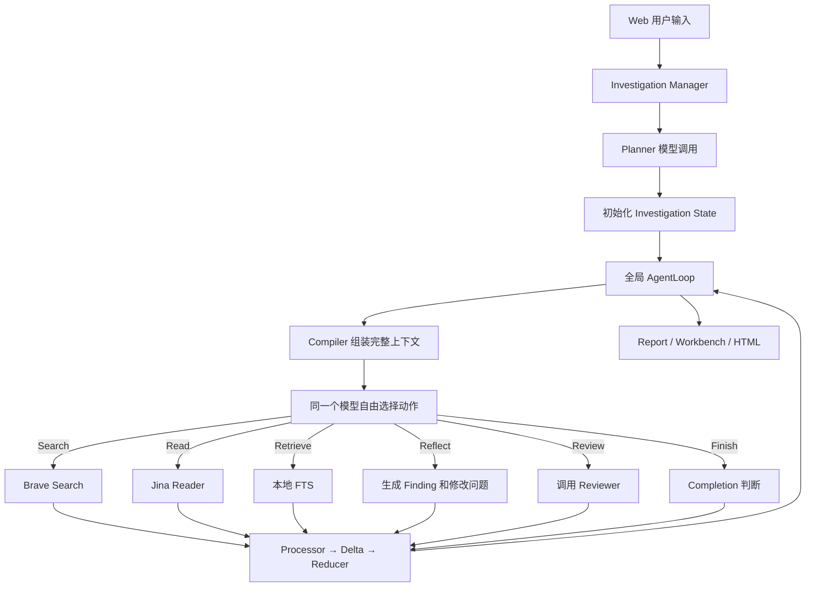
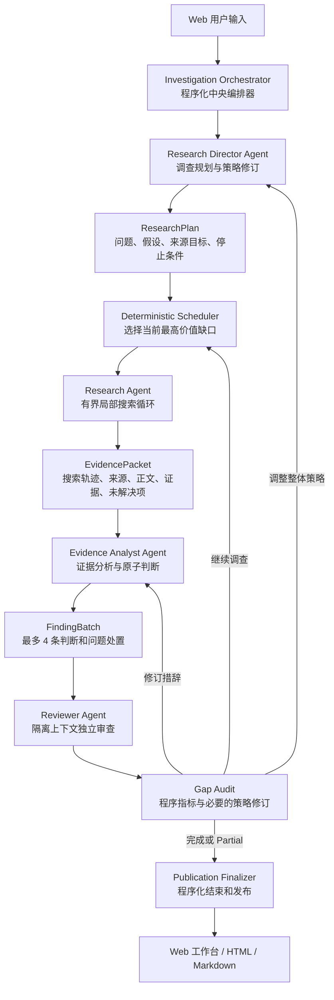

# OpinionSearch 当前架构与分层多 Agent 架构对比

> 文档状态：**架构提案，已否决（2026-09-21）**；2026-09-24 按代码校正
>
> 日期：2026-09-16（提案）／2026-09-21（否决并归档）
>
> 范围：OpinionSearch Web 公开事件调查链路
>
> 重要边界：本文中的“当前架构”来自现有代码与真实运行；“目标架构”是本文提出的候选设计，
> **不是当前系统，也未被采纳**。
>
> **结论（2026-09-21）**：本提案已实施为一次独立实验
> （`opinion_search_agent/archive/harness-pipeline/`），评估后否决并归档。否决理由：
> ① 违反单 Runtime 原则——该流水线是与 Runtime 零共享代码的第二个 loop，
> 全部可靠性机制都长在唯一的 Runtime AgentLoop 上；
> ② 与生产路径能力重复且更弱——「整体骨架 → 定向搜索」已由 PagePlan + search_targets 实现，
> 而实验的 GenericPlanner 对任何事件产出同样的固定任务模板；
> ③ 工程质量差距无法低成本补齐——预算对象从未被调用、LLM 失败静默降级、
> checkpoint 无命名空间。
> 决策记录见 `opinion_search_agent/archive/harness-pipeline/README.md`。
> 本文 §1–§3 对“当前架构”的描述仍然准确；§4–§17 应作为**被否决的提案**阅读。

## 1. 文档目的

OpinionSearch 当前已经具备可恢复运行、不可变正文、证据定位、状态归约、失败保留、报告导出和 Web 工作台等工程能力，但真实案例表明，它还不能稳定地把搜索材料转化为经过审查、可以发布的深度舆情报告。

当前主要问题不是完全搜不到材料，而是全局 Agent Prompt 同时承担规划、问题选择、搜索、读取、正文检索、判断合成、问题处置、审查调度和结束判断。模型在一个平铺 AgentLoop 中自由选择全部动作，Harness 主要负责验证错误和兜底，没有充分承担调查调度职责。

本文对比当前架构与拟议的分层多 Agent 架构，并明确哪些部分保留、哪些部分替换，以及目标架构如何把搜索质量置于首要位置。

## 2. 一句话对比

当前架构：

> 一个全局 Agent 在完整调查上下文中自由选择 Search、Read、Retrieve、Reflect、Review 或 Finish，Harness 主要检查它是否违反约束。

目标架构：

> 程序化 Orchestrator 控制阶段、问题轮转、统一预算和发布条件；Research Director 负责调查策略，Research Agent 在局部任务内主动搜索，Evidence Analyst 形成小批量原子判断，Reviewer 立即核查，报告从已审查状态确定性生成。

## 3. 当前架构

### 3.1 当前工作链路



### 3.2 当前主 Agent 的职责

当前全局 Agent 每一步都需要同时判断：

1. 当前应调查哪个问题。
2. 应该搜索、读取还是重新检索正文。
3. 应使用什么查询词和来源方向。
4. 哪个候选页面值得读取。
5. 当前材料是否足以生成 Finding。
6. 是否需要修改问题或组件状态。
7. 是否应该发起 Review。
8. Review 后是否需要补证据或改写。
9. 是否已经可以 Finish。
10. 剩余预算是否足以完成调查。

当前动作联合类型相当于：

```text
SearchDecision
| ReadDecision
| RetrieveDecision
| ReflectDecision
| ReviewDecision
| FinishDecision
```

这使同一 Prompt 同时承担搜索策略、调查分析、状态处置和运行控制。随着来源、证据、问题和 Finding 增加，上下文不断变长，模型容易集中于最近的局部问题，而忽略全局覆盖和收束成本。

### 3.3 当前架构的优势

当前架构已有以下可保留能力：

- Web 调查草稿、澄清和恢复。
- Manager 负责调查生命周期和进程锁。
- 通用异步 AgentLoop。
- Decision → Action → Observation → Delta → Reducer。
- JSON Checkpoint 和已提交状态恢复。
- Brave Search、Jina Reader 和本地 FTS5。
- 不可变正文版本、正文哈希和字符定位。
- Source、Evidence、Finding、Review 和 Issue 的结构化状态。
- ActionResultCache 和重试语义。
- `partial`、`failed`、`cancelled` 的真实保留。
- 动态 Workbench、静态 HTML 和 Markdown。
- 链路诊断从已提交状态派生。
- 未审查 Finding 不会被当作核心结论发布。

这些能力解决了“不要错误地成功”，不应在架构升级中被推翻。

### 3.4 当前架构的主要问题

#### 3.4.1 全局动作选择空间过大

模型每一步都能选择所有动作。Prompt 必须不断提醒模型什么时候搜索、读取、反思、审查和结束，但这些提示属于软约束，无法保证执行。

#### 3.4.2 问题轮转只是提示，不是调度

虽然上下文包含搜索覆盖和缺口，模型仍可连续深挖同一个问题，而其他必答问题没有获得最低搜索机会。

#### 3.4.3 搜索策略没有独立状态

查询调整隐藏在下一次 SearchDecision 中，没有明确记录：

- 上一方向为什么失败；
- 当前准备切换到什么查询族；
- 是否出现来源集中；
- 是否已经搜索饱和；
- 为什么继续或停止。

#### 3.4.4 Reflect 职责过重

一次 Reflect 可能同时：

- 创建多个 Finding；
- 退休旧 Finding；
- 修改 Issue；
- 修改问题组件；
- 新增问题；
- 判断回应覆盖；
- 建立来源关系；
- 填充页面专项字段。

Prompt 即使要求只生成 1–4 条 Finding，如果 Validator 没有执行数量约束，模型仍可能一次产生更多判断。

#### 3.4.5 Review 依赖主 Agent 主动选择

Finding 形成后，主 Agent 仍可继续搜索和读取。预算提前结束时，可能留下大量未审查 Finding。

#### 3.4.6 Finish 依赖模型主动提出

只有模型选择 Finish，CompletionEvaluator 才会运行。模型可能过早 Finish、连续提出无效 Finish，或者一直不 Finish，最终由 Runtime 步骤上限被动终止。

#### 3.4.7 多种预算相互独立

Runtime 步骤、模型调用、搜索、读取、总时间和收束时间分别判断，没有统一计算剩余资源是否足以完成 Reflect、Review、问题处置和 Finish。

## 4. 目标分层多 Agent 架构

### 4.1 总体结构



### 4.2 设计原则

目标架构遵循以下分工：

| 职责 | Agent | 程序 Harness |
|---|---:|---:|
| 理解问题和事件语义 | 是 | 维护结构 |
| 生成调查假设 | 是 | 验证数量与关联 |
| 设计查询词 | 是 | 指定任务和预算 |
| 判断搜索是否低产出 | 是 | 提供确定性指标 |
| 主动切换搜索方向 | 是 | 限制合法范围 |
| 识别缺少的主体 | 是 | 维护来源角色覆盖 |
| 问题轮转 | 否 | 是 |
| 全局预算分配 | 否 | 是 |
| 预留 Review 和 Finish | 否 | 是 |
| 维护 ID 和状态版本 | 否 | 是 |
| 发布未审查结论 | 禁止 | 程序阻止 |
| 持久化和恢复 | 否 | 是 |

目标不是降低 Agent 智能，而是把智能集中在搜索策略、结果判断和证据理解上，把资源控制和发布安全交给程序。

## 5. 目标组件

### 5.1 Investigation Orchestrator

Orchestrator 是程序化生命周期控制器，不是自由 LLM Agent。

建议阶段：

```text
IDENTIFY
→ PLAN
→ COVERAGE
→ ANALYZE_AND_REVIEW
→ DEEPEN
→ GAP_AUDIT
→ FINALIZE
→ TERMINAL
```

模型不能自由跳转阶段。例如：

- COVERAGE 阶段不能直接 Finish。
- 有待处理 FindingBatch 时不能继续无关搜索。
- 有未审查 Finding 时必须优先 Review 或修复。
- 进入发布保留区后不能继续普通搜索。
- FINALIZE 阶段不能创建新问题。

### 5.2 Research Director Agent

Director 负责宏观调查策略，不直接调用搜索工具。

主要输出：

- 事件别名和机构实体；
- 调查问题及组成部分；
- 每个问题的优先级；
- 当前假设；
- 所需来源角色；
- 停止条件；
- 需要创建的 ResearchTask。

Director 只在以下情况重新调用：

- 事件身份或范围改变；
- 原假设被证据推翻；
- 连续搜索低信息增益；
- 某类来源策略失效；
- 出现重要新主体或新争议；
- Reviewer 连续指出同类证据缺口；
- 用户提出新的更新重点。

### 5.3 Deterministic Scheduler

Scheduler 由程序实现，负责问题轮转和任务优先级。

第一轮采用最低覆盖原则：所有必答问题先获得一次调查机会。在存在完全未调查的必答问题时，同一问题原则上不能连续获得多个普通搜索任务。

第二轮按以下顺序深化：

1. 用户明确要求的问题。
2. 影响核心结论的事实缺口。
3. 回应覆盖缺口。
4. Review 失败且值得补证据的问题。
5. 完全没有材料的问题。
6. 已有部分答案但缺少次要内容的问题。

Scheduler 必须阻止：

- 单个问题吸走全部预算；
- 有大量未读候选时继续宽泛搜索；
- 官方来源已经充分时继续收集同类官方材料；
- 未审查 Finding 积累后仍继续扩大材料集。

### 5.4 Research Agent

Research Agent 是唯一拥有局部 AgentLoop 的角色。

它每次只处理一个明确 ResearchTask，例如：

```json
{
  "task_id": "task-hearing-opinions-01",
  "issue_id": "issue-hearing-opinions",
  "objective": "找到听证会上不同主体的实际意见和争议焦点",
  "source_goals": [
    "stakeholder_positions",
    "independent_reporting"
  ],
  "local_budget": {
    "searches": 3,
    "reads": 3,
    "model_calls": 8,
    "steps": 8
  },
  "stop_conditions": [
    "识别至少两个明确观点主体",
    "连续两次搜索没有新增高价值来源",
    "达到局部预算"
  ]
}
```

允许的局部动作：

```text
Search
Read
Retrieve
ReviseLocalStrategy
ReturnEvidencePacket
```

Research Agent 可以主动：

- 扩展事件别名；
- 使用机构名、文号和参与者姓名搜索；
- 切换站点和来源方向；
- 从事件发生时材料切换到后续材料；
- 识别转载并追溯原始出处；
- 判断连续查询已经饱和；
- 请求 Director 修订全局策略。

它不能修改全局问题、生成最终 Finding、决定整个调查完成或直接发布报告。

### 5.5 EvidencePacket

Research Agent 不返回自由文本报告，而是返回结构化 EvidencePacket：

```text
EvidencePacket
├── task_id / issue_id
├── search_trace
├── sources
├── evidence
├── source_relation_proposals
├── coverage_delta
├── unresolved
└── stop_reason
```

合法停止原因包括：

```text
goal_satisfied
results_saturated
source_unavailable
provider_failure
budget_exhausted
strategy_revision_required
```

`provider_failure` 和 `budget_exhausted` 不能被解释成 `not_found`。

### 5.6 Evidence Analyst Agent

Analyst 只处理已保存正文和 EvidencePacket，不访问互联网。

职责包括：

- 区分事实、归因说法、解释和诉求；
- 识别主体和态度对象；
- 形成时间线事件；
- 分析回应覆盖；
- 形成原子 Finding；
- 更新问题组件；
- 提出下一轮证据缺口。

一次输出最多：

- 4 条新 Finding；
- 6 个组件 Assessment；
- 4 个新 Gap；
- 必要的 SourceRelation Proposal。

这些数量由 Validator 强制，不只写在 Prompt 中。

### 5.7 Reviewer Agent

Reviewer 与 Research Agent 和 Analyst 隔离上下文，只接收：

- Finding；
- 对应问题；
- 精确证据片段；
- 来源元数据；
- 必要的来源关系。

Reviewer 检查：

- 日期、数字和范围是否完整支持；
- 是否把归因说法写成事实；
- 是否把计划执行写成已经执行；
- 是否把转载当作独立验证；
- 是否把部分回应写成充分回应；
- 是否把材料样本写成公众总体态度。

Review 路由：

| Verdict | 后续处理 |
|---|---|
| supported | 冻结并提交 Finding |
| partial，可通过措辞修复 | Analyst 修订一次后重新 Review |
| partial，需要新材料 | 创建定向 ResearchTask |
| contradicted | 撤回或建立争议关系 |
| insufficient | 撤回或转为未知 |
| provider failure | 保持 unreviewed，不解释成证据不足 |

### 5.8 Publication Finalizer

Finalizer 由程序调用，不由 Research Agent 决定。

完整结束要求：

- 所有必答组件都有终态；
- 没有未处理 EvidencePacket；
- 没有未审查的对外 Finding；
- 核心结论均来自当前 supported Finding；
- 完成规则通过。

允许主动形成合格 Partial：

- 搜索范围已经满足限定要求；
- 剩余问题已经明确处置为 not_found 或 unavailable；
- 对外判断全部经过审查；
- 页面明确显示查找范围和缺失原因。

## 6. 关键机制对照

### 6.1 Planner 与 Director

| | 当前 Planner | 目标 Director |
|---|---|---|
| 调用时机 | 调查开始 | 开始及必要策略检查点 |
| 是否搜索 | 否 | 否 |
| 维护假设 | 很弱 | 是 |
| 定义来源目标 | 粗略 | 按问题定义 |
| 定义停止条件 | 基本没有 | 是 |
| 响应 Review 失败 | 否 | 是 |
| 修订任务队列 | 否 | 提交结构化修订 |

### 6.2 全局 AgentLoop 与局部 Research AgentLoop

| | 当前全局 Loop | 目标局部 Loop |
|---|---|---|
| 作用范围 | 整个调查 | 单个 ResearchTask |
| 可见问题 | 全部问题 | 一个问题或关联组件 |
| 可见来源 | 全部来源 | 当前任务相关来源 |
| 动作类型 | 六类全局动作 | Search/Read/Retrieve/Revision/Return |
| 是否决定 Review | 是 | 否 |
| 是否决定 Finish | 是 | 否 |
| 预算 | 全局但相互独立 | 局部配额来自统一 Ledger |
| 主要目标 | 决定下一步做什么 | 把一个具体证据缺口查清 |

### 6.3 Reflect 与 Analyst

| | 当前 Reflect | 目标 Analyst |
|---|---|---|
| 输入范围 | 全局 State | 一个 EvidencePacket 及相关问题 |
| Finding 数量 | Prompt 建议，可能超量 | Validator 强制最多 4 条 |
| 是否搜索 | 不直接搜索 | 不搜索 |
| 是否修改多个问题 | 可能 | 严格限制相关问题 |
| 是否建立来源关系 | 可以同时处理 | 只提交有限 Proposal |
| Review 时机 | 由主 Agent 决定 | 输出后自动触发 |

### 6.4 可选 Review 与强制 Review

当前：

```text
Reflect
→ 主 Agent 可能继续 Search / Read / Retrieve
→ 预算可能结束
→ Finding 保持 unreviewed
```

目标：

```text
Analyst 输出 FindingBatch
→ Orchestrator 强制 Reviewer
→ Review 完成后才允许继续无关调查
```

### 6.5 被动终止与主动结束

当前：

```text
模型没有 Finish
→ Runtime 达到 max_steps 或时间预算
→ 被动 partial
```

目标：

```text
Gap Audit 判断继续搜索价值较低
→ 剩余问题获得终态处置
→ Review 当前判断
→ 主动完成或主动 partial
```

## 7. 统一预算设计

### 7.1 当前预算

当前存在彼此独立的：

- Runtime `max_steps`；
- 模型请求上限；
- 搜索请求上限；
- 正文读取上限；
- 总时间；
- 收束时间和模型调用阈值。

这些预算没有统一计算最低收尾成本。

### 7.2 目标 ResourceLedger

```text
ResourceLedger
├── director_calls
├── research_model_calls
├── analyst_calls
├── reviewer_calls
├── searches
├── reads
├── elapsed_seconds
├── runtime_transitions
└── publication_reserve
```

动态发布保留至少包括：

```text
等待分析的 EvidencePacket
+ 尚未生成 Finding 时需要的 Analyst 调用
+ ceil(未审查 Finding / Review Batch Size)
+ 允许的一次措辞修复
+ Gap Audit
+ Finalization
+ 安全余量
```

Research Agent 不得消费 publication reserve。

`max_steps` 退回为异常防循环 Watchdog。正常调查应该由领域预算和 Orchestrator 主动结束，不应依赖 Runtime 步骤上限形成 Partial。

## 8. 状态模型对照

### 8.1 保留的全局状态

继续保留：

```text
Request
Profile
Issues / Components
Candidates
Sources / SourceVersions
Evidence
Findings
Reviews
SourceRelations
SearchAttempts
ConclusionIds
```

### 8.2 新增状态

```text
ResearchPlan
ResearchTask
SearchStrategy
EvidencePacket
FindingBatch
AgentRunRecord
GapAudit
BudgetReservation
FrozenFinding
StrategyRevision
```

关联关系：

```text
ResearchPlan
    └── ResearchTask[]
            └── EvidencePacket[]
                    └── FindingBatch[]
                            └── ReviewRecord[]
```

目标系统必须能够回答：

- 为什么创建这次搜索任务；
- Search Agent 为什么切换查询方向；
- 为什么停止搜索；
- 某个 Finding 来自哪个任务和正文；
- Review 失败后创建了哪个补查任务；
- 每个任务实际消耗了多少预算。

## 9. 状态提交与 Agent 边界

所有 Agent 读取带 revision 的只读快照：

```json
{
  "snapshot_revision": 42,
  "task_id": "task-1",
  "allowed_issue_ids": [],
  "allowed_source_ids": [],
  "allowed_evidence_ids": []
}
```

Agent 只能返回 Proposal：

```text
Agent Proposal
→ Validator
→ Processor
→ Delta
→ Reducer
→ Checkpoint
```

Agent 不生成最终 ID，也不能直接写全局 State。

Review 通过的 Finding 默认冻结。只有新矛盾证据、正文版本变化、来源关系修正、更新任务或审查错误才能显式重开。

## 10. Checkpoint 对照

当前主要保存一个全局 AgentLoop Checkpoint。

目标架构保留全局 Investigation Checkpoint，并增加局部 ResearchTask Checkpoint：

```text
investigation checkpoint
├── phase
├── research plan
├── task queue
├── global state
├── resource ledger
└── active task id

research task checkpoint
├── local strategy
├── local step
├── query history
├── candidate ranking
├── local budget
└── pending evidence packet
```

Research Agent 崩溃后，只恢复当前局部任务，不重新执行整个调查。

## 11. 报告生成对照

报告仍由程序从领域状态生成，不引入自由写作的 Report Agent。

主报告只使用：

- supported Finding；
- 明确标注的 disputed Finding；
- 已获得终态的问题；
- 经核实的来源关系；
- 有正文定位的 Evidence；
- 明确的未知和限制。

如后续增加 Narrative Composer，它只能重排和改写已审查 Finding，不得增加事实，每句话必须绑定 Finding ID，并再次进行引用一致性检查。

## 12. 并行策略

首版保持串行运行：

- 一个共享任务队列；
- 一个 Research Agent Worker；
- 全局共享 Corpus；
- EvidencePacket 依次提交；
- Analyst 和 Reviewer 小批量运行。

首版不允许 Agent 自由通信。

只有在串行质量稳定后，才考虑最多两个并行 Research Worker，并要求：

- 处理不同任务；
- 使用同一只读状态快照；
- 不直接提交全局状态；
- 中央 Processor 负责去重和合并；
- 全局 Ledger 原子扣费；
- 检测 revision 冲突。

## 13. 同一保留案例的链路对照

### 13.1 当前真实轨迹

重庆轨道交通票价机制案例的主要动作：

```text
Search 原始方案
Read 听证公告
Read 最终通知
Retrieve
Retrieve
Reflect 11 条 Finding
Retrieve
Search 听证观点
Read 公告
Search 听证观点
Retrieve
Search 官方回应
Read 政策问答
Retrieve
Retrieve
Read 新闻
Search 听证观点
Search 听证观点
Search 后续措施
Retrieve
达到 20 步
```

结果：

```text
4 个正文版本
34 条 Evidence
11 条 Finding
0 条 Review
0 条 Conclusion
6 个必答问题保持 open
```

### 13.2 目标预期轨迹

```text
Director 建立问题、假设、来源目标和停止条件

Scheduler 选择“票价规则”任务
Research Agent 搜索并读取最终通知
Analyst 生成不超过 4 条原子 Finding
Reviewer 立即审查并冻结通过项

Scheduler 选择“听证观点”任务
Research Agent 搜索听证记录、参与者和本地报道
搜索饱和后返回 EvidencePacket 和明确 unresolved
Analyst 处置参会结构及观点缺口
Reviewer 核查

Scheduler 依次处理公众负担、运营成本、回应和实施情况

Gap Audit 将已完成限定搜索但仍缺材料的组件标为
not_found 或 unavailable

Finalizer 发布 reviewed conclusions 和明确限制
```

即使最终仍为 Partial，它也应是主动完成的有界 Partial，而不是因为 Runtime 步骤耗尽留下大量 open 和 unreviewed 状态。

## 14. 代码组件迁移表

| 当前组件 | 目标处理 |
|---|---|
| `InvestigationManager` | 保留，改为启动 Orchestrator |
| 通用 `AgentLoop` | 保留，只用于局部 Research Agent |
| 全局 `Compiler` | 拆分成 Director、Research、Analyst、Reviewer Context Builder |
| 全局 `Decision` 联合类型 | 按角色拆分 |
| `Validator` | 保留并拆分角色 Validator |
| `Resolver` | Search/Read/Retrieve 归属 Research Agent |
| `Executor` | 保留 |
| `Processor` | 保留并支持新 Proposal |
| `Reducer` | 保留并扩展计划、任务和 Packet Delta |
| `CompletionEvaluator` | 移到 Orchestrator Finalize 阶段 |
| `ConsolidationValidator` | 由统一预算和阶段控制替代 |
| `Budget` | 升级为 ResourceLedger |
| `Corpus` | 保留 |
| FTS5 | 保留 |
| `Report` / `Workbench` | 保留，消费 reviewed state |
| `Diagnostics` | 扩展 Agent、任务和搜索质量指标 |
| Web 主结构 | 保留，增加策略和任务进度投影 |

## 15. 实施边界

首版目标架构保持：

- 单机本地运行；
- Web 为主要入口；
- 单进程串行调查；
- Brave 与 Jina；
- 本地不可变正文和 SQLite FTS5；
- 中文报告；
- 不直接采集社交平台；
- 不建设分布式调度；
- 不建设多租户；
- 不自动对外回应；
- 不新增自由聊天式 Agent 协议。

多 Agent 架构在这里表示职责和上下文隔离，不等于多个进程、多个模型供应商或并行 Agent 群。

## 16. 架构决策（提案原文与最终结论）

**提案（2026-09-16）**：OpinionSearch 的目标架构确定为：

> 使用分层多 Agent 架构。程序化 Investigation Orchestrator 维护全局计划、任务队列、统一预算、状态和完成条件；Research Director 负责调查策略；Research Agent 在单一缺口和局部预算内自主搜索；Evidence Analyst 将冻结材料转化为小批量原子判断；Reviewer 在隔离上下文中核查引用支持性；所有结果经 Validator、Processor、Delta、Reducer 提交；报告由已审查状态确定性生成。首版串行运行，不允许 Agent 自由通信或直接修改全局状态。

本次升级的本质不是简单地从一个模型变成多个模型，而是：

```text
从：
模型控制全局平铺 ReAct Loop

转为：
程序控制调查阶段和资源
+ Agent 主动调整局部搜索策略
+ 小批量证据分析
+ 强制即时审查
+ 主动完成或主动 Partial
```

**最终结论（2026-09-21）：否决。** 上述提案已实现为独立实验并归档，
理由见文首「结论」与 `archive/harness-pipeline/README.md`。

被保留下来的是**目标而非拓扑**。提案中「程序控制资源与发布条件、Agent 主动调整搜索策略、
强制即时审查、主动完成或主动 Partial」四项，已在唯一 Runtime 上实现，无需引入角色分工：

| 提案目标 | 当前实现 |
|---|---|
| 程序控制资源与发布条件 | `Budget` + `ConsolidationValidator` 的 2/3 模型调用保留段 |
| Agent 主动调整搜索策略 | Agent 在合法动作空间内自主选择；`required_next_action` 提供覆盖提示 |
| 强制即时审查 | 发布保留段强制先 review 全部 active Finding 再 finish |
| 主动完成或主动 Partial | `CompletionPolicy` 的四种 disposition → RunStatus |

## 17. 验收关注点

新架构是否有效，不以 Agent 数量或调用次数衡量，而以以下结果衡量：

- 必答问题最低覆盖率；
- 原始来源命中率；
- 来源角色覆盖；
- 搜索新增材料率；
- 重复正文比例；
- 有效读取率；
- Evidence → Finding 转化率；
- Finding 审查通过率；
- 必答问题终态处置率；
- 在统一预算内完成 Review 和 Finalize 的比例；
- 主动 Partial 与 Runtime 被动终止的比例；
- 相比当前冻结案例，人工评估的回答质量是否提高。

如果新架构只增加模型调用和系统复杂度，却没有提高问题闭合率、审查通过率和收束成功率，则多 Agent 改造不成立。
